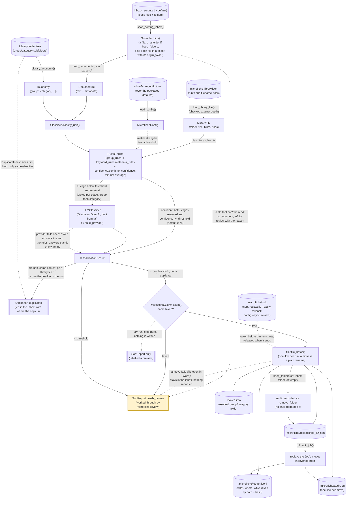

# Module diagram

Two Mermaid diagrams. The first, the import graph, is generated by `make module-diagram` from the actual
`packages/core/src/microfiche/core` and `packages/cli/src/microfiche/cli` source (the import statements, not the prose in
[architecture/overview.md](overview.md)) as of 2026-10-31; that date moves when the graph changes. The second, the
runtime data flow, is written by hand. If the first drifts from the code, trust the code and regenerate it
rather than editing it to match a stale diagram.

## 1. Module import graph

Every internal `from microfiche.core...`/`from microfiche.cli...` import, grouped by subpackage. `core` has no
dependency on `cli` (per [architecture/overview.md](overview.md)); all edges point the other way.

```mermaid
flowchart TD
    subgraph CLI["packages/cli/src/microfiche/cli"]
        cli_init["__init__.py"]
        cli_app["app.py"]
        cli_commands["commands.py"]
        cli_display["display.py"]
        cli_review["review.py"]
        cli_logging["logging.py"]
        cli_progress["progress.py"]
        cli_streams["streams.py"]
        cli_init_prompts["init_prompts.py"]
        cli_json_output["json_output.py"]
    end

    subgraph CORE["core (top level)"]
        core_organizer["organizer.py"]
        core_scanner["scanner.py"]
        core_classifier["classifier.py"]
        core_filer["filer.py (file_batch + rollback_job)"]
        core_ledger["ledger.py"]
        core_reclassify["reclassify.py"]
        core_config["config.py"]
        core_duplicates["duplicates.py"]
        core_runlock["runlock.py"]
        core_review["review.py"]
        core_library_init["library_init.py"]
        core_learning["learning.py"]
        core_drift["drift.py"]
        core_watcher["watcher.py"]
    end

    subgraph MODELS["core/models"]
        m_document["document.py"]
        m_unit["unit.py"]
        m_category["category.py"]
        m_classification["classification.py"]
        m_audit["audit_event.py"]
        m_job["job.py"]
        m_ledger["ledger.py"]
    end

    subgraph PARSERS["core/parsers"]
        p_init["__init__.py (public interface)"]
        p_registry["registry.py (dispatcher)"]
        p_base["base.py"]
        p_txt["txt_parser.py"]
        p_md["markdown_parser.py"]
        p_pdf["pdf_parser.py"]
        p_docx["docx_parser.py"]
        p_msg["msg_parser.py"]
        p_eml["eml_parser.py"]
    end

    subgraph RULES["core/rules"]
        r_engine["rules_engine.py"]
        r_group["group_rules.py"]
        r_keyword["keyword_rules.py"]
        r_metadata["metadata_rules.py"]
        r_confidence["confidence.py"]
        r_ambiguity["ambiguity.py"]
        r_normalise["normalise.py"]
    end

    subgraph AI["core/ai"]
        a_base["base.py"]
        a_prompts["prompts.py"]
        a_llm["llm_classifier.py"]
        a_ollama["ollama_provider.py"]
        a_openai["openai_provider.py"]
        a_factory["factory.py (build_provider)"]
        a_check["check.py"]
    end

    subgraph LIBRARY["core/library"]
        l_library["library.py (Library)"]
        l_suggester["category_suggester.py"]
        l_naming["naming.py"]
        l_library_file["library_file.py (LibraryFile)"]
        l_library_sync["library_sync.py"]
    end

    subgraph UTILS["core/utils"]
        u_filesystem["filesystem.py"]
        u_hashing["hashing.py"]
        u_errors["errors.py"]
    end

    cli_init --> cli_app
    cli_init --> cli_streams

    cli_app --> cli_commands

    cli_commands --> cli_display
    cli_commands --> a_llm
    cli_commands --> core_config
    cli_commands --> l_suggester
    cli_commands --> core_organizer
    cli_commands --> core_reclassify
    cli_commands --> core_filer
    cli_commands --> core_scanner
    cli_commands --> a_factory
    cli_commands --> l_library
    cli_commands --> core_runlock
    cli_commands --> cli_logging
    cli_commands --> cli_progress
    cli_commands --> l_library_sync
    cli_commands --> core_ledger
    cli_commands --> cli_review
    cli_commands --> core_review
    cli_commands --> cli_init_prompts
    cli_commands --> core_library_init
    cli_commands --> l_library_file
    cli_commands --> a_base
    cli_commands --> a_check
    cli_commands --> core_classifier
    cli_commands --> cli_json_output
    cli_commands --> m_unit
    cli_commands --> core_drift
    cli_commands --> core_watcher

    cli_display --> core_config
    cli_display --> core_organizer
    cli_display --> core_reclassify
    cli_display --> m_job
    cli_display --> core_filer
    cli_display --> l_library_file
    cli_display --> l_library_sync
    cli_display --> core_classifier

    core_organizer --> a_llm
    core_organizer --> core_classifier
    core_organizer --> core_filer
    core_organizer --> l_library
    core_organizer --> m_classification
    core_organizer --> m_job
    core_organizer --> m_unit
    core_organizer --> core_scanner
    core_organizer --> core_duplicates
    core_organizer --> u_filesystem
    core_organizer --> l_library_sync

    core_scanner --> m_unit
    core_scanner --> p_init
    core_scanner --> l_library
    core_scanner --> u_filesystem

    core_classifier --> m_category
    core_classifier --> m_classification
    core_classifier --> m_document
    core_classifier --> m_unit
    core_classifier --> r_confidence
    core_classifier --> l_library
    core_classifier --> r_engine

    core_filer --> core_ledger
    core_filer --> l_library
    core_filer --> l_naming
    core_filer --> m_audit
    core_filer --> m_classification
    core_filer --> m_job
    core_filer --> m_ledger
    core_filer --> m_unit
    core_filer --> u_filesystem
    core_filer --> u_hashing
    core_filer --> u_errors

    core_ledger --> m_ledger

    core_reclassify --> core_classifier
    core_reclassify --> core_filer
    core_reclassify --> l_library
    core_reclassify --> m_classification
    core_reclassify --> m_unit
    core_reclassify --> p_init
    core_reclassify --> core_ledger

    m_unit --> m_document

    m_job --> m_audit

    p_init --> p_registry

    p_registry --> m_document
    p_registry --> p_base
    p_registry --> p_txt
    p_registry --> p_md
    p_registry --> p_pdf
    p_registry --> p_docx
    p_registry --> p_msg
    p_registry --> p_eml
    p_registry --> u_errors

    p_base --> m_document

    p_txt --> p_base
    p_txt --> m_document

    p_md --> p_base
    p_md --> m_document

    p_pdf --> p_base
    p_pdf --> m_document

    p_docx --> p_base
    p_docx --> m_document

    p_msg --> p_base
    p_msg --> m_document

    p_eml --> p_base
    p_eml --> m_document

    r_engine --> m_category
    r_engine --> m_classification
    r_engine --> m_document
    r_engine --> r_group
    r_engine --> r_keyword
    r_engine --> r_metadata
    r_engine --> core_config
    r_engine --> l_library_file

    r_group --> m_classification
    r_group --> r_ambiguity
    r_group --> r_normalise

    r_keyword --> m_classification
    r_keyword --> r_ambiguity
    r_keyword --> r_normalise

    r_metadata --> m_classification

    a_llm --> a_base
    a_llm --> a_prompts
    a_llm --> m_category
    a_llm --> m_classification
    a_llm --> m_document
    a_llm --> core_config

    l_library --> core_config
    l_library --> m_category
    l_library --> u_filesystem
    l_library --> l_library_file
    l_library --> core_ledger

    l_suggester --> m_document

    a_factory --> a_base
    a_factory --> a_ollama
    a_factory --> a_openai
    a_factory --> core_config

    l_library_file --> core_config

    core_duplicates --> core_filer
    core_duplicates --> l_library
    core_duplicates --> m_classification
    core_duplicates --> m_unit
    core_duplicates --> u_hashing

    core_runlock --> l_library
    core_runlock --> u_errors

    cli_logging --> core_config
    cli_logging --> l_library

    cli_progress --> cli_logging

    l_library_sync --> l_library
    l_library_sync --> l_library_file
    l_library_sync --> r_normalise

    cli_review --> cli_display
    cli_review --> core_review

    core_review --> a_llm
    core_review --> core_duplicates
    core_review --> core_filer
    core_review --> core_organizer
    core_review --> l_library
    core_review --> m_classification
    core_review --> m_job
    core_review --> m_unit
    core_review --> core_config
    core_review --> u_filesystem
    core_review --> u_hashing
    core_review --> core_learning

    cli_init_prompts --> core_library_init

    core_library_init --> core_config
    core_library_init --> l_library
    core_library_init --> l_library_file
    core_library_init --> l_library_sync

    a_base --> u_errors

    a_check --> a_base
    a_check --> a_factory
    a_check --> core_config

    a_ollama --> a_base

    a_openai --> a_base

    r_ambiguity --> r_normalise

    core_learning --> core_config
    core_learning --> core_ledger
    core_learning --> l_library
    core_learning --> l_library_file
    core_learning --> l_library_sync
    core_learning --> m_ledger
    core_learning --> p_init
    core_learning --> r_normalise

    cli_json_output --> core_classifier
    cli_json_output --> core_config
    cli_json_output --> core_filer
    cli_json_output --> core_organizer
    cli_json_output --> core_reclassify
    cli_json_output --> core_review
    cli_json_output --> l_library
    cli_json_output --> l_library_sync
    cli_json_output --> m_classification
    cli_json_output --> m_job
    cli_json_output --> m_unit
    cli_json_output --> core_drift

    core_drift --> core_ledger
    core_drift --> l_library
    core_drift --> m_ledger
    core_drift --> u_hashing

    core_watcher --> core_config
    core_watcher --> core_drift
    core_watcher --> core_organizer
    core_watcher --> core_runlock
    core_watcher --> core_scanner
    core_watcher --> l_library
    core_watcher --> l_library_file
```

Every module in the graph is imported by another. `library/templates.py` and `utils/validation.py` were removed as unused
in the Stage 6 simplification review (see [feature-backlog.md](../rfcs/RFC-007-group-templates.md)). The
Obsidian modules that used to sit here were removed from the MVP and are kept in
[feature-backlog.md](../rfcs/RFC-002-obsidian-integration.md).

## 2. Sort pipeline data flow

What actually happens at runtime when `microfiche sort` runs, as opposed to what imports what.

Solid arrows are wired end to end today; dashed arrows and the highlighted box are the `review` queue, which
`microfiche review` works through (`core/review.py`) and files with the same `file_batch`.
`reclassify.py` reuses `Classifier`/`RulesEngine` the same way against already-filed documents
instead of the `_sorting/` inbox; with `--apply` it files its `move` proposals through the same
`filer.file_batch`, so a reclassification is a job like any other.

## See also

- [architecture/overview.md](overview.md) — the design narrative these diagrams visualize.
- [mvp-roadmap.md](../requirements/mvp-roadmap.md) — status per feature.
- [data-model.md](data-model.md) — the ledger, `AuditEvent`, `Job` and `audit.log` schemas referenced here.
