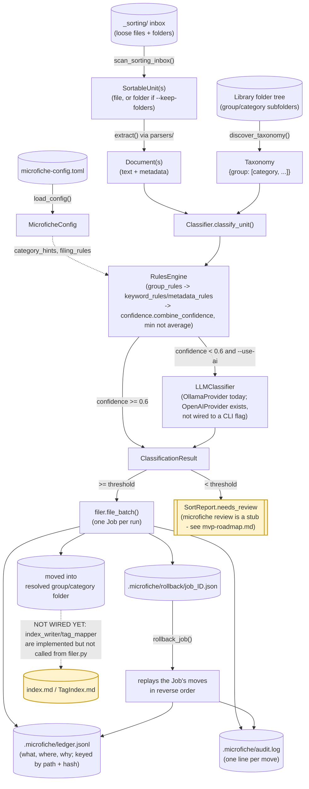

# Module diagram

Two Mermaid diagrams generated from the actual `packages/core/src/core` and
`packages/cli/src/cli` source (grepped import statements, not the prose in
[architecture.md](architecture.md)) as of 2026-10-04. If this drifts from the code, trust the
code and regenerate this file rather than editing it to match a stale diagram.

## 1. Module import graph

Every internal `from core...`/`from cli...` import, grouped by subpackage. `core` has no
dependency on `cli` (per [architecture.md](architecture.md)); all edges point the other way.

```mermaid
flowchart TD
    subgraph CLI["packages/cli/src/cli"]
        cli_init["__init__.py"]
        cli_app["app.py"]
        cli_commands["commands.py"]
        cli_display["display.py"]
        cli_review["review.py (stub)"]
    end

    subgraph CORE["core (top level)"]
        core_organizer["organizer.py"]
        core_scanner["scanner.py"]
        core_extractor["extractor.py"]
        core_classifier["classifier.py"]
        core_filer["filer.py (file_batch + rollback_job)"]
        core_ledger["ledger.py"]
        core_resort["resort.py"]
        core_config["config.py"]
    end

    subgraph MODELS["core/models"]
        m_document["document.py"]
        m_unit["unit.py"]
        m_category["category.py"]
        m_classification["classification.py"]
        m_audit["audit_event.py"]
        m_job["job.py"]
        m_ledger["ledger.py"]
    end

    subgraph PARSERS["core/parsers"]
        p_init["__init__.py (dispatcher)"]
        p_base["base.py"]
        p_txt["txt_parser.py"]
        p_md["markdown_parser.py"]
        p_pdf["pdf_parser.py"]
        p_docx["docx_parser.py"]
        p_msg["msg_parser.py"]
        p_eml["eml_parser.py"]
    end

    subgraph RULES["core/rules"]
        r_engine["rules_engine.py"]
        r_group["group_rules.py"]
        r_keyword["keyword_rules.py"]
        r_metadata["metadata_rules.py"]
        r_confidence["confidence.py"]
    end

    subgraph AI["core/ai"]
        a_base["base.py"]
        a_prompts["prompts.py"]
        a_llm["llm_classifier.py"]
        a_ollama["ollama_provider.py"]
        a_openai["openai_provider.py (unused - no --provider flag yet)"]
    end

    subgraph LIBRARY["core/library"]
        l_taxonomy["taxonomy.py"]
        l_suggester["category_suggester.py"]
        l_naming["naming.py"]
        l_folder_mapping["folder_mapping.py"]
        l_templates["templates.py (unused - no create-library command yet)"]
    end

    subgraph OBSIDIAN["core/obsidian (implemented, not yet called from the pipeline)"]
        o_index_writer["index_writer.py"]
        o_tag_index["tag_index.py"]
        o_tag_mapper["tag_mapper.py"]
    end

    subgraph UTILS["core/utils"]
        u_filesystem["filesystem.py"]
        u_hashing["hashing.py"]
        u_logging["logging.py (unused)"]
        u_validation["validation.py (unused)"]
    end

    cli_init --> cli_app
    cli_app --> cli_commands
    cli_commands --> cli_display
    cli_commands --> a_llm
    cli_commands --> a_ollama
    cli_commands --> core_config
    cli_commands --> l_suggester
    cli_commands --> core_organizer
    cli_commands --> core_resort
    cli_commands --> core_filer
    cli_commands --> core_scanner
    cli_display --> core_config
    cli_display --> core_organizer
    cli_display --> core_resort

    core_organizer --> a_llm
    core_organizer --> core_classifier
    core_organizer --> core_config
    core_organizer --> core_filer
    core_organizer --> l_taxonomy
    core_organizer --> m_audit
    core_organizer --> m_classification
    core_organizer --> m_job
    core_organizer --> m_unit
    core_organizer --> r_engine
    core_organizer --> core_scanner

    core_scanner --> core_extractor
    core_scanner --> m_unit
    core_scanner --> p_init

    core_extractor --> m_document
    core_extractor --> p_init

    core_classifier --> a_llm
    core_classifier --> m_category
    core_classifier --> m_classification
    core_classifier --> m_unit
    core_classifier --> r_confidence
    core_classifier --> r_engine

    core_filer --> core_config
    core_filer --> core_ledger
    core_filer --> l_folder_mapping
    core_filer --> l_naming
    core_filer --> m_audit
    core_filer --> m_classification
    core_filer --> m_job
    core_filer --> m_ledger
    core_filer --> m_unit
    core_filer --> u_filesystem
    core_filer --> u_hashing

    core_ledger --> m_ledger

    core_resort --> core_classifier
    core_resort --> core_config
    core_resort --> core_extractor
    core_resort --> l_taxonomy
    core_resort --> m_classification
    core_resort --> m_unit
    core_resort --> p_init
    core_resort --> r_engine
    core_resort --> u_filesystem

    m_unit --> m_document
    m_job --> m_audit

    p_init --> m_document
    p_init --> p_txt
    p_init --> p_md
    p_init --> p_pdf
    p_init --> p_docx
    p_init --> p_msg
    p_init --> p_eml
    p_base --> m_document
    p_txt --> m_document
    p_md --> m_document
    p_pdf --> m_document
    p_docx --> m_document
    p_msg --> m_document
    p_eml --> m_document

    r_engine --> m_category
    r_engine --> m_classification
    r_engine --> r_confidence
    r_engine --> r_group
    r_engine --> r_keyword
    r_engine --> r_metadata
    r_group --> m_classification
    r_keyword --> m_classification
    r_metadata --> m_classification

    a_llm --> a_base
    a_llm --> a_prompts
    a_llm --> m_category
    a_llm --> m_classification

    l_taxonomy --> m_category
    l_taxonomy --> u_filesystem
    l_suggester --> m_document
    l_templates --> u_filesystem

    o_tag_mapper --> o_tag_index
```

**Read against [mvp-roadmap.md](mvp-roadmap.md):** the isolated nodes above (`openai_provider.py`,
`templates.py`, the `logging.py` and `validation.py` helpers, and the entire `core/obsidian`
subgraph) aren't dead code — they're implemented and tested, just not yet called from
`organizer.py`/`filer.py`.
That's the gap this roadmap doc tracks, not a diagramming omission.

## 2. Sort pipeline data flow

What actually happens at runtime when `microfiche sort` runs, as opposed to what imports what.

Solid arrows are wired end to end today; dashed arrows and the highlighted boxes are real code
paths (`core/obsidian/`, the `review` queue) that nothing in the `sort` pipeline calls yet.
`resort.py` reuses `Classifier`/`RulesEngine` the same way against already-filed documents
instead of the `_sorting/` inbox, and is dry-run only until `--apply` is wired to
`filer.file_batch`.

## See also

- [architecture.md](architecture.md) — the design narrative these diagrams visualize.
- [mvp-roadmap.md](mvp-roadmap.md) — status per feature; explains every "not yet wired" node above.
- [data-model.md](data-model.md) — the ledger, `AuditEvent`, `Job` and `audit.log` schemas referenced here.
